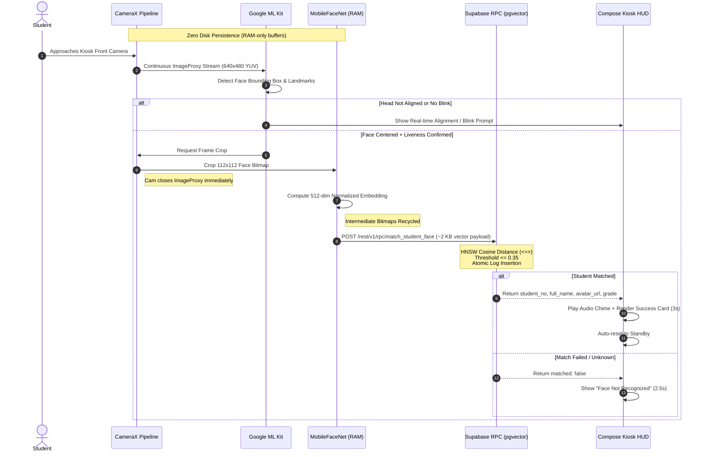

# System Architecture & Technical Specifications

## 1. Overview
The **Techxodia School Kiosk Login System** is a zero-local-persistence, unattended facial recognition attendance terminal engineered for Android tablets operating in dedicated Single-App Lock Task Mode.

The system is optimized for high-throughput morning arrivals (1500+ students per gate) with sub-second end-to-end verification, strict student privacy protection, and white-label multi-tenancy.

---

## 2. End-to-End Architectural Data Flow



---

## 3. Critical Architectural Decisions

### 3.1: Bandwidth & Latency Comparison
Traditional cloud facial recognition architectures upload compressed JPEG images (500 KB – 2 MB per attempt) to a server. On a 10-kiosk gate cluster during 7:30 AM arrival rush, this creates severe network bottlenecks and latency jitter (1200 ms – 3000 ms).

| Architecture | Payload Size | Uplink Bandwidth (10 kiosks @ 20 req/min) | Network Latency | End-to-End Verification Time |
| :--- | :--- | :--- | :--- | :--- |
| **Raw Cloud Upload** | 500 KB – 2 MB | ~20 – 40 Mbps | 450 – 1200 ms | 1500 – 3500 ms |
| **Techxodia On-Device TFLite** | **~2 KB** (512 floats) | **< 70 Kbps** | **30 – 60 ms** | **180 – 350 ms** |

### 3.2: Zero Local Persistence Guarantee (FERPA & GDPR Compliance)
* **No Disk Caching:** Biometric vectors, cropped facial bitmaps, and raw frames are never stored in SQLite, Room, DataStore, or SharedPreferences.
* **Immediate RAM Recycling:** As soon as a cropped bitmap is passed to `FaceEmbeddingExtractor`, `scaledBitmap.recycle()` and `imageProxy.close()` are synchronously invoked.
* **Network Offline Policy:** If Supabase is unreachable, the kiosk transitions to a visual offline state. Biometric attempts are **never queued to local disk** to prevent physical device theft compromise.

### 3.3: Liveness & Anti-Spoofing Defense
1. **Pose Bounding Check:** Evaluates head Euler angles ($|Yaw| \le 15^\circ$, $|Pitch| \le 15^\circ$) to eliminate peripheral passersby.
2. **Active Liveness Blink Challenge:** Evaluates average eye opening ratio ($Left_{open} + Right_{open} / 2$). Detects the transition from open ($\ge 0.70$) to shut ($\le 0.25$) to open ($\ge 0.70$).
3. **Synthetic Distance Rejection:** Flat photo cutouts and digital tablet replays fail the dynamic transition challenge.

---

## 4. Multi-Tenant Dynamic Theme Injection

```
                  ┌────────────────────────────────────────┐
                  │          assets/tenant_config.json     │ (Compile-time Fallback)
                  └───────────────────┬────────────────────┘
                                      │
                     Boot Fallback    │
                                      ▼
┌──────────────────┐    Fetch Config   ┌────────────────────────────────────────┐
│  Kiosk Activity  │ ◄──────────────── │   Supabase `tenant_branding` Table     │
└────────┬─────────┘                   └────────────────────────────────────────┘
         │
         ▼
┌────────────────────────────────────────────────────────┐
│  DynamicTenantTheme (MaterialTheme 3 Token Injection)   │
│  - primaryColor (Header, verification states)          │
│  - accentColor (Guide brackets, Kiosk locked badge)    │
│  - schoolName, logoUrl, kioskLocationId                │
└────────────────────────────────────────────────────────┘
```
